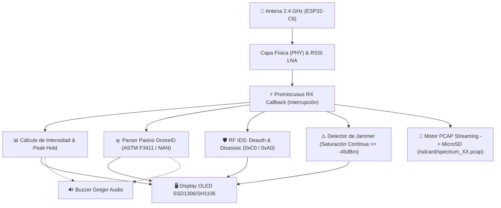
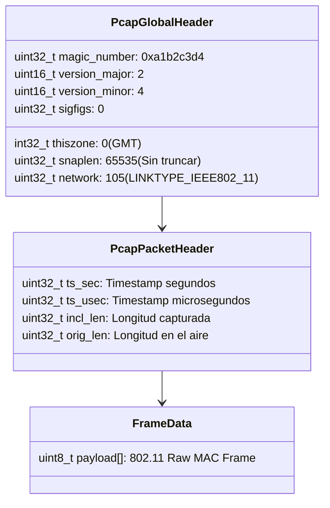

# 2.9 RF Spectrum Analyzer Avanzado: Fox Hunting, Captura PCAP y Detección de Drones (DroneID)

El **Analizador de Espectro RF de Minino** (`Applications > Spectrum`) transforma el transceptor de radio de 2.4 GHz del **ESP32-C6** en una herramienta de grado forense y cacería física de emisores. 

A diferencia de un simple escáner de redes Wi-Fi basado en llamadas a nivel de sistema operativo (`scan`), el motor de Spectrum opera directamente sobre la **capa física (PHY) y de enlace de datos (MAC)** mediante el modo promiscuo del hardware. Esto le permite capturar, medir y analizar cualquier emisión electromagnética en la banda, independientemente de si la trama está cifrada, corrupta, si proviene de redes ocultas o incluso de tecnologías ajenas a Wi-Fi estándar (como balizas de drones o inhibidores de señal).

---

## 🧭 Visión Global de la Arquitectura RF



---

## 🦊 1. Modo Fox Hunting: Cacería Física de Transmisores

### 1.1 Principios Físicos de la Radiogoniometría (Direction Finding)
El *Fox Hunting* (cacería del zorro) es la disciplina de localizar geográficamente un emisor de radio desconocido basándose en la intensidad de campo recibido (**RSSI - Received Signal Strength Indicator**).

En el espacio libre, la potencia de una onda electromagnética decae según la **Ley de Atenuación en Espacio Libre (FSPL)**:

$$FSPL(dB) = 20\log_{10}(d) + 20\log_{10}(f) + 20\log_{10}\left(\frac{4\pi}{c}\right)$$

Donde $d$ es la distancia y $f$ es la frecuencia (2.4 GHz). En términos prácticos:
* **Cada vez que se duplica la distancia entre Minino y el emisor, la potencia recibida cae aproximadamente 6 dBm**.
* Una señal a 1 metro rondará entre **-30 dBm y -40 dBm**.
* A 10 metros rondará entre **-60 dBm y -70 dBm**.
* Al límite de recepción rondará entre **-85 dBm y -95 dBm**.

> [!TIP]
> **Técnica de Atenuación por Sombra Corporal (Body Shielding):**
> Al cazar un emisor con una antena omnidireccional estándar, coloca a Minino pegado a tu pecho y gira lentamente sobre tu propio eje $360^\circ$. El cuerpo humano (compuesto por un 70% de agua) atenúa la señal de 2.4 GHz entre **15 y 20 dBm**. La dirección en la que el medidor de proximidad marque el **mínimo relativo** indica que el emisor está **exactamente a tu espalda**; por el contrario, cuando marque el **máximo relativo**, el objetivo está **directamente frente a ti**.

---

### 1.2 Interfaz Gráfica del Medidor de Proximidad (OLED 128×64)

La pantalla de Fox Hunting (`SPECTRUM_VIEW_FOXHUNT`, accesible pulsando el botón derecho **▶ RIGHT** en Spectrum) fue diseñada específicamente para proporcionar máxima visibilidad y respuesta instantánea bajo la luz solar:

```text
┌────────────────────────────────────────────────────────┐
│ C06*  -54dB  T:-75*                       [HEADER]     │
│ -90   -70   -50   -30                     [PÁGINA 1]   │
│   |     |     |     |                     [TICKS]      │
│ ┌────────────────────────────────────────────────────┐ │
│ │█████████████████████████████   |    :              │ │
│ └────────────────────────────────────────────────────┘ │
│ PROX: 62%   PK:-48                        [PÁGINA 5]   │
│ +-Ch  >FOX   A  CAP                       [FOOTER]     │
└────────────────────────────────────────────────────────┘
```

#### Elementos del Medidor:
1. **Escala de Calibración Superior (Página 1 y Ticks):**
   * Marcas graduadas en posiciones estratégicas: `-90 dBm`, `-70 dBm`, `-50 dBm` y `-30 dBm`.
   * Permite evaluar cuantitativamente la severidad de la aproximación sin depender únicamente de un número abstracto.
2. **Barra de Proximidad de Alto Contraste (116 × 16 píxeles):**
   * Rango dinámico normalizado:
     $$Prox(\%) = \frac{RSSI - (-95)}{(-25) - (-95)} \times 100$$
   * Proporciona una respuesta visual continua de 0% a 100%.
3. **Indicador de Retención de Pico (Peak Hold Line `|`):**
   * Una línea vertical dentro de la barra almacena el nivel más alto registrado en la sesión reciente.
   * Si apuntas en una dirección y la barra actual no alcanza la línea de pico, sabes de inmediato que **te estás alejando o apuntando fuera del lóbulo principal**.
4. **Marcador de Silenciamiento / Squelch (`:` punteado):**
   * Muestra visualmente el umbral (`Threshold`) fijado por el usuario. Las señales por debajo de este nivel no llenan la barra, aislando el ruido ambiental de fondo.
5. **Lectura Numérica Dual (Página 5):**
   * `PROX: XXX%`: Porcentaje instantáneo.
   * `PK: -XXdBm`: Pico numérico en decibelios. Si hay drones en el canal, conmuta automáticamente a `DRN: XX`.

---

## 💾 2. Captura Forense Directa a PCAP (MicroSD)

### 2.1 El Formato Estándar Libpcap
Para que una captura inalámbrica sea admisible en herramientas de análisis como **Wireshark**, **tshark** o **NetworkMiner**, no se pueden guardar cadenas de texto plano arbitrarias; deben estructurarse respetando el estándar binario **libpcap**.

Minino genera directamente en la MicroSD un archivo binario compuesto por:
1. **Global Header (24 bytes):** Escrito una sola vez al inicializar el archivo.
2. **Packet Record Header (16 bytes):** Precede a cada trama capturada.
3. **Packet Data (Payload 802.11 raw):** La trama completa recibida por el radio.



### 2.2 Rotación Automática y Prevención de Desgaste
* **Nombres Secuenciales:** El sistema busca en `/sdcard/` desde `spectrum_00.pcap` hasta `spectrum_99.pcap`. Si encuentra un archivo existente, avanza al siguiente índice libre, **garantizando que ninguna captura previa se sobrescriba**.
* **Búfering y Flush:** Para no desgastar las celdas flash de la MicroSD ni penalizar la interrupción del radio Wi-Fi, Minino no invoca `fsync()` en cada paquete individual. Se utiliza un búfer intermedio que vacía los bloques a disco cada **50 paquetes**.
* **Activación por Hardware o Terminal:**
  * **Pulsación larga del botón ABAJO (▼ DOWN long press):** Alterna la grabación al instante.
  * **Comando serial:** `spectrum_pcap on`, `spectrum_pcap off`, `spectrum_pcap toggle`.
* **Indicación no intrusiva:** La actividad se refleja en el pie de pantalla con la etiqueta `"CAP"`.

---

## 🛸 3. Detección Integrada de Drones (DroneID / Remote ID)

### 3.1 Fundamentos de Remote ID (FAA & EASA)
Las regulaciones internacionales (FAA Parte 89 en EE.UU. y EASA en Europa) exigen que todo dron comercial o recreativo de más de 250 gramos transmita periódicamente su identificación y telemetría por radiofrecuencia (Direct Remote ID / Broadcast Remote ID).

Los fabricantes (como DJI, Autel, Parrot) implementan esto utilizando tres métodos en la banda de 2.4 GHz:
1. **Information Elements (IE) en Beacons Wi-Fi (ASTM F3411 / ASD-STAN):**
   Las balizas habituales de 802.11 incorporan un elemento de proveedor específico (`Vendor Specific IE = 0xDD`) con el identificador organizacional (**OUI**) asignado:
   * **ASD-STAN / ASTM F3411:** OUI `FA:0B:BC`, Tipo `0x0D`.
   * **Direct Remote ID (Francia):** OUI `6A:5C:35`.
2. **Wi-Fi Aware (NAN - Neighbor Awareness Networking):**
   Tramas de acción públicas (Public Action Frames) donde el dron publica un servicio con el hash SHA-256 de identificación de Remote ID: `88:69:19:9D:92:09`.

### 3.2 El Motor de Inspección Pasiva en Minino (`rf_spectrum_drone.c`)

Cada vez que el hardware del ESP32-C6 recibe una trama, el parser inspecciona los primeros bytes del encabezado MAC:

```c
/* Estructura del Vendor Specific IE para Remote ID */
typedef struct __attribute__((packed)) {
    uint8_t element_id;     /* 0xDD */
    uint8_t length;         /* Longitud del payload del elemento */
    uint8_t oui[3];         /* 0xFA, 0x0B, 0xBC */
    uint8_t oui_type;       /* 0x0D */
    uint8_t message_data[]; /* Bloque OpenDroneID */
} opendroneid_ie_t;
```

Si la firma coincide:
1. Se extrae el **UAS ID (Número de Serie Único)** del dron (hasta 20 caracteres alfanuméricos).
2. Se incrementa el contador de drones en el canal actual (`drone_count[ch]++`).
3. Se proyecta de inmediato un banner de alta prioridad en pantalla: `! DRONE CH X !`.
4. El buzzer emite un tono acústico diferenciado de 30 ms.
5. La información queda registrada en memoria para ser consultada mediante el comando de consola `spectrum_drone`.

---

## ⚠️ 4. Detección de Inhibidores (RF Jammer Detection)

### 4.1 ¿Qué es un Jammer de Radiofrecuencia?
Un inhibidor de señal (*jammer*) es un dispositivo que inyecta ruido electromagnético continuo o pulsos deliberados en las frecuencias de 2.4 GHz para colapsar la relación señal/ruido ($SNR$), impidiendo que los receptores legítimos puedan sincronizarse con las cabeceras de las tramas.

Existen principalmente tres tipos de ataques de jamming:
1. **Continuous Wave (CW / Barrido continuo):** Una portadora de RF pura sin modulación transmitida a alta potencia.
2. **Noise Jamming (Ruido blanco gaussiano):** Modulación de ruido que eleva artificialmente el piso de ruido por encima de -60 dBm.
3. **Deauth / Protocol Jamming:** Saturación masiva de tramas legítimas de desautenticación.

### 4.2 Algoritmo de Detección en Minino
El radio del ESP32-C6 no solo escucha tramas decodificables; su amplificador de bajo ruido (LNA) y detector de potencia en recepción (RSSI) miden la energía electromagnética bruta en la banda.

Minino ejecuta el siguiente algoritmo en cada ciclo de barrido (cada 20 ms):

$$\text{Si } RSSI \ge -45\text{ dBm} \implies \text{Streak} \leftarrow \text{Streak} + 1$$
$$\text{Si } \text{Streak} \ge 20 \text{ (~400 ms ininterrumpidos)} \implies \mathbf{ALERTA\ JAMMER}$$
$$\text{Si } RSSI < -45\text{ dBm} \implies \text{Streak} \leftarrow \max(0, \text{Streak} - 1)$$

* **¿Por qué se requiere un Streak de 20 barridos?**
  Las comunicaciones legítimas (descarga de un archivo pesado por Wi-Fi o streaming de video) generan picos elevados de señal, pero ocurren en **ráfagas discontinuas** separadas por silencios de contienda (CSMA/CA). Una señal que permanece fija por encima de **-45 dBm** durante casi medio segundo sin decaer representa una saturación continua anormal del medio físico.

> [!NOTE]
> **Falsos Positivos en Laboratorio:**
> Si tienes la placa Minino conectada por USB a tu computadora portátil a menos de 30 cm de la antena Wi-Fi integrada de la laptop mientras navegas, el RSSI puede rondar los -35 dBm y activar la advertencia. Para pruebas de campo, mantén a Minino separado de tus propios emisores.

---

## 🛠️ 5. Guía de Comandos de Consola Serial

Puedes controlar y auditar todas las nuevas funciones a través de la interfaz serial conectándote a **115200 baudios** (`/dev/ttyACM0`):

| Comando | Parámetros | Descripción Técnica |
| :--- | :--- | :--- |
| `spectrum_pcap` | `[on\|off\|toggle]` | Consulta el estado de grabación o inicia/detiene el volcado `.pcap` en la MicroSD. |
| `spectrum_drone` | `[clear]` | Despliega las estadísticas de tramas DroneID recibidas por canal y el último UAS ID detectado. |
| `spectrum_ids` | `[clear]` | Muestra el reporte de alertas de desautenticación (0xC0) y detección de jammers activos. |
| `threshold` | `[<dBm\|off>]` | Configura el filtro de umbral squelch (ej. `threshold -70` ignora señales menores a -70 dBm). |
| `spectrum_audio` | `[on\|off\|toggle]` | Activa o silencia el clic acústico tipo contador Geiger proporcional a la intensidad de señal. |
| `spectrum_band` | `[wifi\|zigbee]` | Alterna entre los 14 canales Wi-Fi y los 16 canales IEEE 802.15.4 / Zigbee. |
| `exit_app` | *Ninguno* | Cierra limpiamente el analizador de espectro y retorna al menú principal sin reiniciar el sistema. |

---

## 🧪 6. Casos Prácticos de Laboratorio

### Laboratorio A: Cacería de una Baliza Oculta (Fox Hunt)
1. **Preparación del Objetivo:** Enciende un dispositivo emisor (por ejemplo, un teléfono móvil compartiendo red en el canal 6 con SSID oculto).
2. **Configuración en Minino:**
   * Entra a `Applications > Spectrum`.
   * Presiona **▲ UP** o **▼ DOWN** para fijar el canal en `C06`.
   * Presiona **▶ RIGHT** hasta seleccionar el modo `FOX`.
   * Si hay mucho ruido ambiental, pulsa el botón **BOOT** para activar el modo de edición `Th` (Threshold) y sube el umbral a `-75 dBm`.
3. **Localización:**
   * Gira sobre tu eje usando la técnica de blindaje corporal hasta identificar el ángulo con el pico más alto (`PK`).
   * Camina en línea recta hacia el transmisor observando cómo la barra de proximidad pasa del 20% al 85%+.
   * Al estar a menos de 1 metro, la barra alcanzará el 100% (-25 dBm).

---

### Laboratorio B: Captura y Análisis Forense en Wireshark
1. Inserta una tarjeta MicroSD formateada en FAT32 en Minino.
2. Inicia Spectrum y pulsa prolongadamente el botón **▼ DOWN** (o escribe `spectrum_pcap on` en consola). Verifica que en la esquina inferior derecha del display aparezca `"CAP"`.
3. Deja capturar durante 2 o 3 minutos mientras realizas pruebas de radio.
4. Vuelve a mantener presionado **▼ DOWN** para cerrar el archivo libpcap con seguridad.
5. Retira la MicroSD e inserta el archivo en tu computadora:
   ```bash
   wireshark /media/sdcard/spectrum_00.pcap
   ```
6. **Filtros útiles en Wireshark:**
   * Ver solo balizas de drones: `wlan.tag.number == 221 && wlan.tag.oui == fa:0b:bc`
   * Ver ataques DoS de desautenticación: `wlan.fc.type_subtype == 0x000c`
   * Filtrar por dirección MAC del emisor: `wlan.addr == xx:xx:xx:xx:xx:xx`

---

[[Wi-Fi Analyzer y Espectro|⬅️ Volver a 2.7 Wi-Fi Analyzer y Espectro]] | [[Wi-Fi Wardriving con WiGLE|Siguiente: 2.8 Wi-Fi Wardriving ➡️]]

#minino #esp32c6 #spectrum #fox-hunting #pcap #droneid #ciberseguridad-rf #hacking-etico
