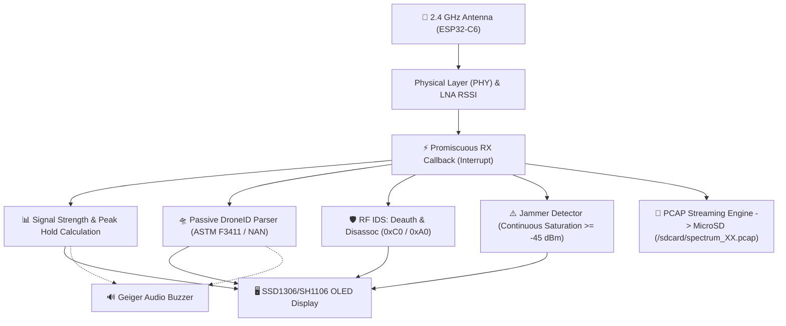
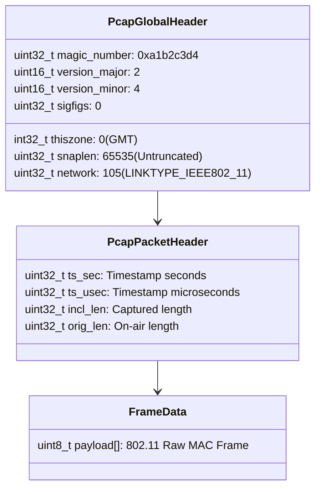

# 2.9 Advanced RF Spectrum Analyzer: Fox Hunting, PCAP Capture, and Drone Detection (DroneID)

The **Minino RF Spectrum Analyzer** (`Applications > Spectrum`) transforms the **ESP32-C6** 2.4 GHz radio transceiver into a forensic-grade analysis and physical transmitter hunting tool.

Unlike a basic Wi-Fi network scanner based on operating system scan calls (`scan`), the Spectrum engine operates directly on the **physical (PHY) and data link (MAC) layers** using hardware promiscuous mode. This enables it to capture, measure, and analyze any electromagnetic emission in the band, regardless of whether frames are encrypted, corrupted, originating from hidden networks, or emitted by non-standard Wi-Fi technologies (such as drone beacons or signal jammers).

---

## 🧭 Global RF Architecture Overview



---

## 🦊 1. Fox Hunting Mode: Physical Transmitter Hunting

### 1.1 Physical Principles of Radio Direction Finding
*Fox Hunting* is the discipline of geographically locating an unknown radio transmitter based on received field strength (**RSSI - Received Signal Strength Indicator**).

In free space, the power of an electromagnetic wave decays according to the **Free Space Path Loss (FSPL)** law:

$$FSPL(dB) = 20\log_{10}(d) + 20\log_{10}(f) + 20\log_{10}\left(\frac{4\pi}{c}\right)$$

Where $d$ is distance and $f$ is frequency (2.4 GHz). In practical terms:
* **Every time the distance between Minino and the transmitter doubles, the received power drops by approximately 6 dBm**.
* A signal at 1 meter typically measures between **-30 dBm and -40 dBm**.
* At 10 meters, it typically measures between **-60 dBm and -70 dBm**.
* At the reception threshold, it ranges between **-85 dBm and -95 dBm**.

> [!TIP]
> **Body Shielding Attenuation Technique:**
> When hunting a transmitter with a standard omnidirectional antenna, hold Minino close to your chest and slowly rotate $360^\circ$ around your axis. The human body (composed of roughly 70% water) attenuates 2.4 GHz signals by **15 to 20 dBm**. The direction where the proximity meter shows a **relative minimum** indicates that the transmitter is **directly behind your back**; conversely, when it reads a **relative maximum**, the target is **directly in front of you**.

---

### 1.2 Proximity Meter Graphical Interface (128x64 OLED)

The Fox Hunting screen (`SPECTRUM_VIEW_FOXHUNT`, accessible by pressing the **▶ RIGHT** button in Spectrum) is designed for maximum visibility and instant responsiveness in outdoor conditions:

```text
┌────────────────────────────────────────────────────────┐
│ C06*  -54dB  T:-75*                       [HEADER]     │
│ -90   -70   -50   -30                     [PAGE 1]     │
│   |     |     |     |                     [TICKS]      │
│ ┌────────────────────────────────────────────────────┐ │
│ │█████████████████████████████   |    :              │ │
│ └────────────────────────────────────────────────────┘ │
│ PROX: 62%   PK:-48                        [PAGE 5]     │
│ +-Ch  >FOX   A  CAP                       [FOOTER]     │
└────────────────────────────────────────────────────────┘
```

#### Meter Elements:
1. **Upper Calibration Scale (Page 1 and Ticks):**
   * Graduated tick marks at strategic positions: `-90 dBm`, `-70 dBm`, `-50 dBm`, and `-30 dBm`.
   * Allows quantitative assessment of approach proximity without relying solely on an abstract percentage.
2. **High-Contrast Proximity Bar (116 x 16 pixels):**
   * Normalized dynamic range:
     $$Prox(\%) = \frac{RSSI - (-95)}{(-25) - (-95)} \times 100$$
   * Provides continuous visual feedback from 0% to 100%.
3. **Peak Hold Indicator (Peak Hold Line `|`):**
   * A vertical line inside the bar stores the highest level recorded during the recent session.
   * If you point in a direction and the current bar falls short of the peak line, you know immediately that **you are moving away or pointing outside the main lobe**.
4. **Squelch / Threshold Marker (dotted `:`):**
   * Visually displays the user-defined `Threshold`. Signals below this level do not fill the bar, isolating ambient background noise.
5. **Dual Numeric Readout (Page 5):**
   * `PROX: XXX%`: Instantaneous proximity percentage.
   * `PK: -XXdBm`: Numeric peak in decibels. If drones are detected on the channel, this automatically switches to `DRN: XX`.

---

## 💾 2. Direct Forensic PCAP Capture (MicroSD)

### 2.1 The Standard Libpcap Format
For a wireless capture to be valid in forensic analysis tools such as **Wireshark**, **tshark**, or **NetworkMiner**, arbitrary plain-text strings cannot be saved; packets must be structured according to the binary **libpcap** standard.

Minino writes a binary file directly to the MicroSD card consisting of:
1. **Global Header (24 bytes):** Written once when initializing the file.
2. **Packet Record Header (16 bytes):** Precedes each captured frame.
3. **Packet Data (Raw 802.11 Payload):** The complete frame received by the radio.



### 2.2 Automatic File Rotation and Wear Prevention
* **Sequential Naming:** The system scans `/sdcard/` from `spectrum_00.pcap` to `spectrum_99.pcap`. When an existing file is found, it advances to the next available index, **ensuring no previous capture is overwritten**.
* **Buffering and Flushing:** To prevent premature wear on MicroSD flash cells and avoid stalling the Wi-Fi radio interrupt, Minino does not call `fsync()` on every individual packet. An intermediate buffer flushes blocks to disk every **50 packets**.
* **Hardware or Terminal Activation:**
  * **Long press on the DOWN button (▼ DOWN long press):** Toggles recording immediately.
  * **Serial command:** `spectrum_pcap on`, `spectrum_pcap off`, `spectrum_pcap toggle`.
* **Non-Intrusive Indicator:** Active recording is shown in the screen footer with the `"CAP"` label.

---

## 🛸 3. Integrated Drone Detection (DroneID / Remote ID)

### 3.1 Remote ID Fundamentals (FAA & EASA)
International aviation regulations (FAA Part 89 in the US and EASA in Europe) require all commercial and recreational drones weighing over 250 grams to periodically broadcast their identification and telemetry via radio frequency (Direct Remote ID / Broadcast Remote ID).

Manufacturers (such as DJI, Autel, and Parrot) implement this using three methods in the 2.4 GHz band:
1. **Information Elements (IE) in Wi-Fi Beacons (ASTM F3411 / ASD-STAN):**
   Standard 802.11 beacons embed a Vendor Specific Information Element (`Vendor Specific IE = 0xDD`) carrying an assigned Organizationally Unique Identifier (**OUI**):
   * **ASD-STAN / ASTM F3411:** OUI `FA:0B:BC`, Type `0x0D`.
   * **Direct Remote ID (France):** OUI `6A:5C:35`.
2. **Wi-Fi Aware (NAN - Neighbor Awareness Networking):**
   Public Action Frames in which the drone advertises a service matching the Remote ID SHA-256 service hash: `88:69:19:9D:92:09`.

### 3.2 Passive Inspection Engine in Minino (`rf_spectrum_drone.c`)

Each time the ESP32-C6 hardware receives a frame, the parser inspects the leading bytes of the MAC header and payload:

```c
/* Vendor Specific IE structure for Remote ID */
typedef struct __attribute__((packed)) {
    uint8_t element_id;     /* 0xDD */
    uint8_t length;         /* Element payload length */
    uint8_t oui[3];         /* 0xFA, 0x0B, 0xBC */
    uint8_t oui_type;       /* 0x0D */
    uint8_t message_data[]; /* OpenDroneID message block */
} opendroneid_ie_t;
```

When a signature matches:
1. The **UAS ID (Unique Serial Number)** of the drone (up to 20 alphanumeric characters) is extracted.
2. The drone counter for the current channel is incremented (`drone_count[ch]++`).
3. A high-priority alert banner is immediately displayed on screen: `! DRONE CH X !`.
4. The buzzer emits a distinct 30 ms acoustic tone.
5. The event is logged in memory and can be queried via the `spectrum_drone` console command.

---

## ⚠️ 4. RF Jammer Detection

### 4.1 What Is an RF Jammer?
A signal jammer is a device that injects continuous electromagnetic noise or deliberate pulses into the 2.4 GHz band to collapse the signal-to-noise ratio ($SNR$), preventing legitimate receivers from synchronizing with frame headers.

There are three primary types of jamming attacks:
1. **Continuous Wave (CW / Continuous Sweep):** A high-power unmodulated pure RF carrier.
2. **Noise Jamming (Additive White Gaussian Noise):** Noise modulation that artificially raises the noise floor above -60 dBm.
3. **Deauth / Protocol Jamming:** Massive flooding of spoofed deauthentication frames.

### 4.2 Detection Algorithm in Minino
The ESP32-C6 radio does not merely listen for decodable frames; its low-noise amplifier (LNA) and receive power detector (RSSI) measure raw electromagnetic energy across the band.

Minino runs the following algorithm on every sweep cycle (every 20 ms):

$$\text{If } RSSI \ge -45\text{ dBm} \implies \text{Streak} \leftarrow \text{Streak} + 1$$
$$\text{If } \text{Streak} \ge 20 \text{ (~400 ms uninterrupted)} \implies \mathbf{JAMMER\ ALERT}$$
$$\text{If } RSSI < -45\text{ dBm} \implies \text{Streak} \leftarrow \max(0, \text{Streak} - 1)$$

* **Why is a streak of 20 sweeps required?**
  Legitimate communications (such as downloading a large file over Wi-Fi or streaming video) generate high signal peaks, but they occur in **discontinuous bursts** separated by contention inter-frame spaces (CSMA/CA). A signal remaining pinned above **-45 dBm** for nearly half a second without decaying indicates abnormal continuous saturation of the physical medium.

> [!NOTE]
> **Laboratory False Positives:**
> If the Minino board is connected via USB to a laptop within 30 cm of the laptop's internal Wi-Fi antenna during active network traffic, the RSSI may hover around -35 dBm and trigger the warning. For field testing, keep Minino separated from your own active transmitters.

---

## 🛠️ 5. Serial Console Command Guide

You can control and audit all Spectrum features through the serial interface at **115200 baud** (`/dev/ttyACM0`):

| Command | Parameters | Technical Description |
| :--- | :--- | :--- |
| `spectrum_pcap` | `[on\|off\|toggle]` | Queries recording status or starts/stops `.pcap` capture to the MicroSD card. |
| `spectrum_drone` | `[clear]` | Displays received DroneID frame statistics per channel and the last detected UAS ID. |
| `spectrum_ids` | `[clear]` | Displays the deauthentication alert report (0xC0) and active jammer detections. |
| `threshold` | `[<dBm\|off>]` | Configures the squelch threshold filter (e.g., `threshold -70` ignores signals below -70 dBm). |
| `spectrum_audio` | `[on\|off\|toggle]` | Enables or mutes Geiger-counter acoustic clicks proportional to signal strength. |
| `spectrum_band` | `[wifi\|zigbee]` | Switches between the 14 Wi-Fi channels and the 16 IEEE 802.15.4 / Zigbee channels. |
| `exit_app` | *None* | Cleanly closes the spectrum analyzer and returns to the main menu without rebooting. |

---

## 🧪 6. Practical Laboratory Exercises

### Lab A: Hunting a Hidden Beacon (Fox Hunt)
1. **Target Setup:** Turn on a transmitting device (for example, a mobile phone hotspot on channel 6 with a hidden SSID).
2. **Minino Configuration:**
   * Navigate to `Applications > Spectrum`.
   * Press **▲ UP** or **▼ DOWN** to lock onto channel `C06`.
   * Press **▶ RIGHT** until `FOX` mode is selected.
   * If ambient noise is high, press the **BOOT** button to enter `Th` (Threshold) edit mode and raise the threshold to `-75 dBm`.
3. **Localization:**
   * Rotate around your axis using the body shielding technique until you identify the angle with the highest peak (`PK`).
   * Walk in a straight line toward the transmitter while watching the proximity bar climb from 20% to 85%+.
   * Within 1 meter of the source, the bar reaches 100% (-25 dBm).

---

### Lab B: Forensic Capture and Analysis in Wireshark
1. Insert a FAT32-formatted MicroSD card into Minino.
2. Launch Spectrum and long-press the **▼ DOWN** button (or run `spectrum_pcap on` in the serial console). Verify that `"CAP"` appears in the bottom-right corner of the display.
3. Capture traffic for 2 to 3 minutes while performing radio tests.
4. Long-press **▼ DOWN** again to safely flush and close the libpcap file.
5. Remove the MicroSD card and open the capture file on your computer:
   ```bash
   wireshark /media/sdcard/spectrum_00.pcap
   ```
6. **Useful Wireshark Display Filters:**
   * View only drone beacons: `wlan.tag.number == 221 && wlan.tag.oui == fa:0b:bc`
   * View deauthentication DoS attacks: `wlan.fc.type_subtype == 0x000c`
   * Filter by transmitter MAC address: `wlan.addr == xx:xx:xx:xx:xx:xx`

---

[[Wi-Fi Analyzer and Spectrum|⬅️ Back to 2.7 Wi-Fi Analyzer and Spectrum]] | [[Wi-Fi Wardriving with WiGLE|Next: 2.8 Wi-Fi Wardriving ➡️]]

#minino #esp32c6 #spectrum #fox-hunting #pcap #droneid #rf-cybersecurity #ethical-hacking
